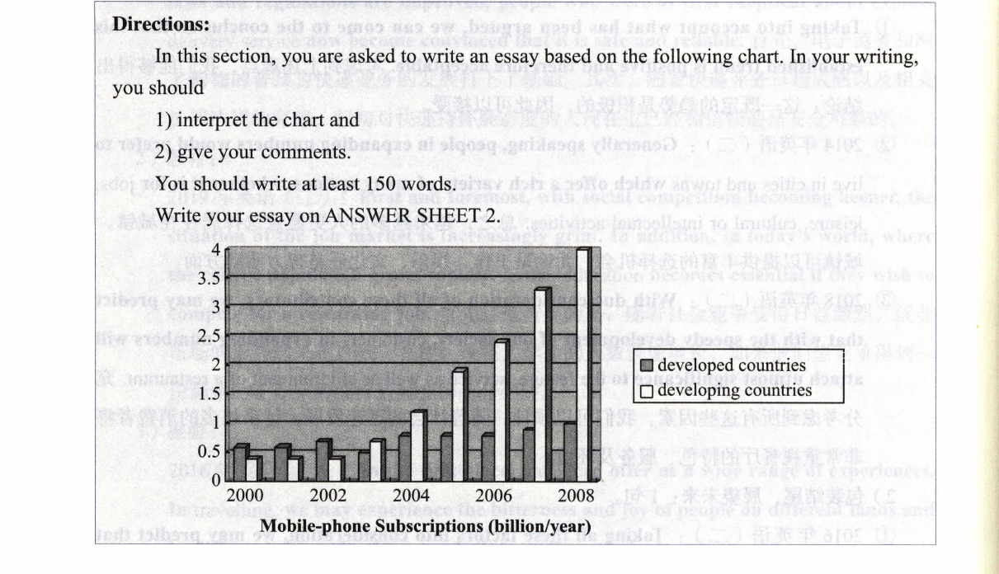

# 2026年10月31日｜S05 停车后大作文首稿或已有稿反馈

今天周六，只做本文件中的一个分支，单次15至20分钟，最多20分钟。先安全停车，再看题和书写。不额外补做其他未回传任务。

## 先确认是否已经写过

- **此前没有写过本题**：可在今天原窗口独立尝试。先保留首稿，首稿前不看范文、解析、中文译文、具体提纲或目标句。通用教学已经发生则如实说明，不能称零教学前测。
- **此前已经写过本题**：保留那份第一次原稿，先交回原稿并说明真实用时与帮助条件。今天窗口用于依据真实稿件反馈、修订一两处；不要求重造“第一次”，未见稿不预设具体错因。
- **记不清或暂时找不到原稿**：先核对、找回或上传，不能把不清楚写成未做，也不另加一份长作业。

如以前看过解析或范文，仍能练习，但把暴露条件记清，不称未见题无提示首稿。

## 来源与完整原题

2010年考研英语二大作文，来自王江涛《新东方（2025）考研英语高分写作》印刷144页、PDF顺序159页。2026年10月31日重新核对原页Directions、原图、图例、坐标和单位，并对照下列已保存题干图。原图未重绘，PNG不含同页命题解析和结构图。沿用此前S02的同一道题和同一张图，不是换了一道新题，也不把此前未回传当成未写。

**图像是完整题目的一部分。** 本Markdown或本地路径单独交给另一个ChatGPT聊天不够，须同时上传下列PNG。图片看不清就停车后放大或请求清晰图，不能猜补数据。

[打开完整题干和原图](2026-10-24_停车后书写_2010英语二题干.png)



Directions:

In this section, you are asked to write an essay based on the following chart. In your writing, you should

1) interpret the chart and
2) give your comments.

You should write at least 150 words.

Write your essay on ANSWER SHEET 2.

## 计时、版本与帮助记录

安全停车后再开始。一次窗口包括读题、书写和可能的自查，最多20分钟；没有要求20分钟内一定完成。到时未完，保存真实截止位置，不自动加时。若之后续写，把续写时间单列，不合并成首稿用时。

若原窗口有余量，先保留首稿再自己检查；自查后版和以后教师帮助后版分别保留。初稿阶段若需要求助，先保存已写部分，记录何时求助及帮助内容，此后不把帮助后的内容混称独立首稿。

本文件不附本题译文、提纲、范文、数据判断或目标句。语音课中的其他主题自编示范不是本题答案，但若已听过，仍记录通用教学条件。

```markdown
# S05书写回传
- 实际写作日期：
- 首稿/此前原稿回收/同题续写/自查修订/教师帮助后修订：
- 对本题的接触：只看过题干/做过/看过解析/看过范文，分别说明：
- 手写或打字；是否使用字典、翻译、自动纠错、范文或提示：
- 此前图表通用教学与其他主题示范是否听过：
- 读题和首稿用时，实际记录依据：
- 20分钟截止时写到哪里；未计时就说明：
- 自查用时及修改，是否在原窗口内：
- 之后续写用时、求助时间和具体帮助，单列：
- 原稿、自查后稿、提示后稿的文件，未发生不补写：
```
