# 计组自组卷A · 测验①（施测版）

> 原定日期2026-10-22；10-23完成核对并发卷，未作答；10-26用户确认今天补测。仅计组部分训练。

满分45分，限时50分钟。11道单选各2分，第12题12分（各问2/4/1/2/3分），第13题11分（各问3/5/3分）。原件与教材解析10-23已核对、评分冻结；10-26重新打开13道题图核对，评分不变。原图题号是教材题号，作答请按本卷第1～13题编号。

作答前记下北京时间开始时刻，并说明是否曾看过这些题的解答；10-23曾发卷的背景保留。闭卷独立完成，不查教材、Anki或解析；不会的可留空并注明是否尚未学过。50分钟到即停笔，交卷时附结束时刻、选择题答案及综合题过程。交卷前不讲解或判分。

第1题采用教材约定：int为32位、short为16位，有符号整数采用补码表示，类型转换按截断及符号扩展约定处理。第13题使用第12题所给计算机条件，题图已附前置材料；只答其教材题06的三个小问。

## 第1题 · 2024 / 2.2 / 教材选择34

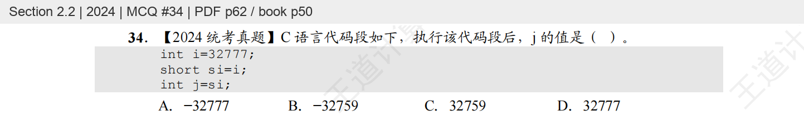

## 第2题 · 2024 / 2.2 / 教材选择35

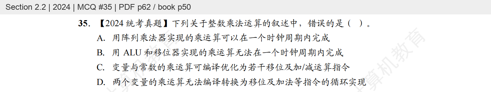

## 第3题 · 2024 / 2.3 / 教材选择51

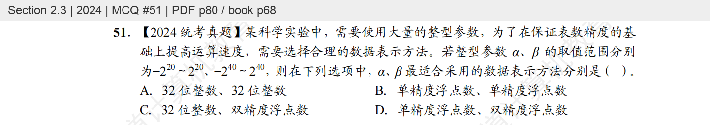

## 第4题 · 2024 / 3.6 / 教材选择22

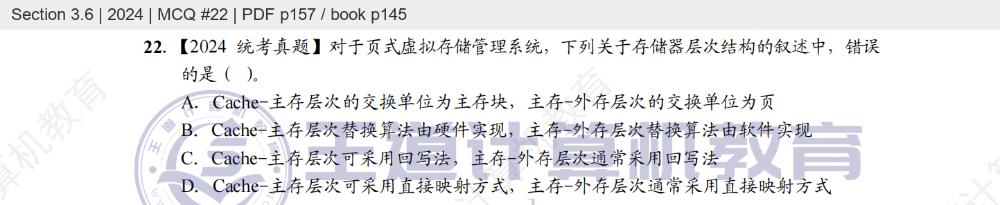

## 第5题 · 2024 / 3.6 / 教材选择23

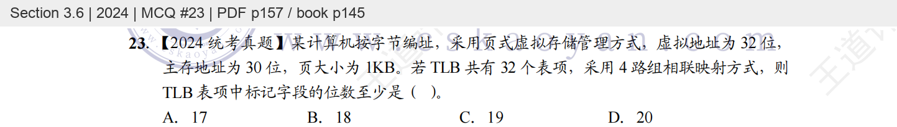

## 第6题 · 2024 / 3.6 / 教材选择24

## 第7题 · 2024 / 5.6 / 教材选择32

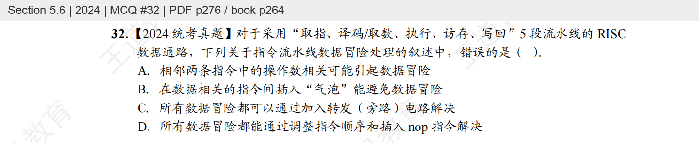

## 第8题 · 2024 / 6.1 / 教材选择28

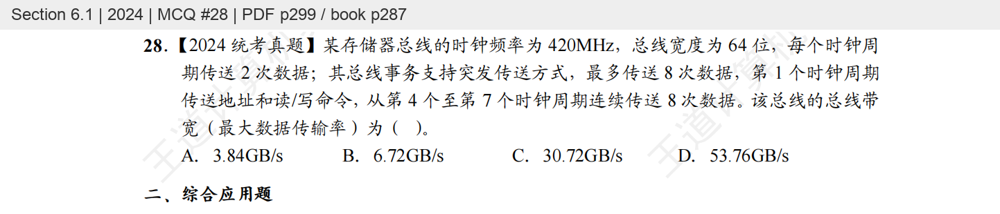

## 第9题 · 2024 / 7.3 / 教材选择56

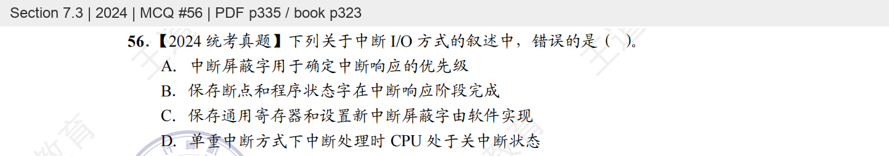

## 第10题 · 2024 / 7.3 / 教材选择57

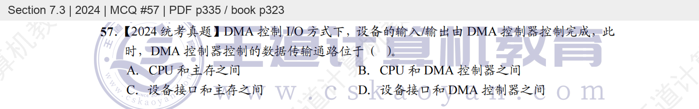

## 第11题 · 2023 / 1.3 / 教材选择32

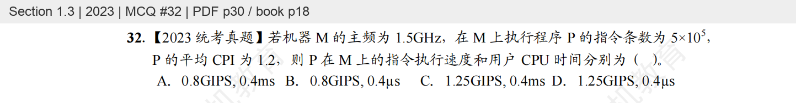

## 第12题 · 2024 / 4.3 / 教材综合05

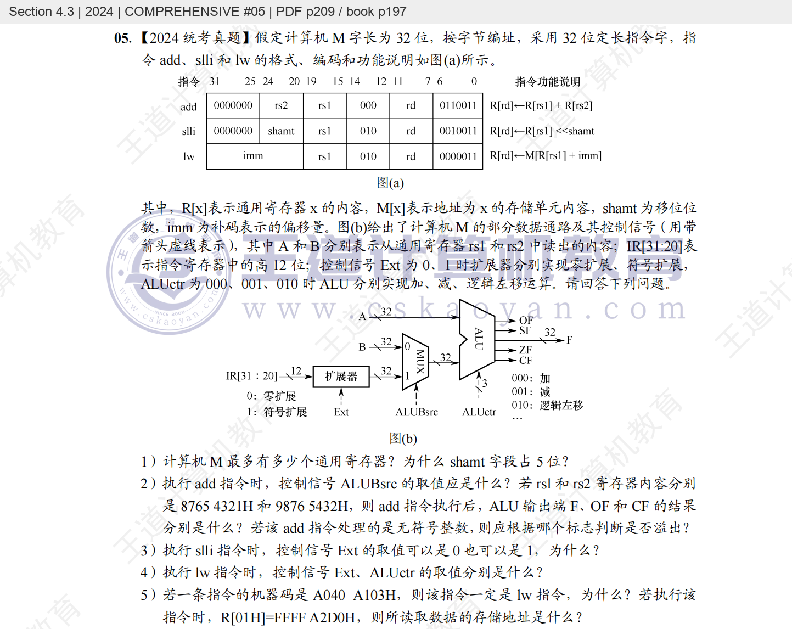

## 第13题 · 2024 / 4.3 / 教材综合06

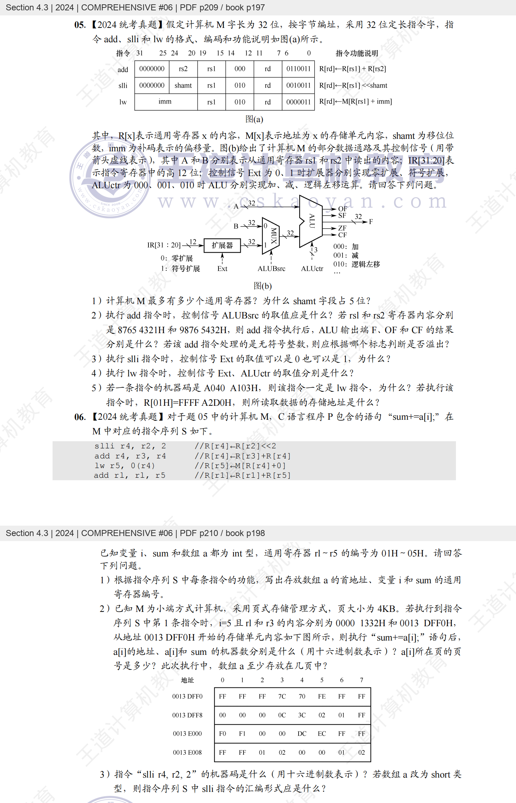

