# 2026-10-25 计组自组卷B（候选）

> 尚未完成施测前核对，请勿提前做题。仅计组部分训练，不是整套408模拟。

拟定45分、50分钟。是否练过、原图条件和评分细则尚待核定，不能据此宣布正式验收达标。原图题号是教材题号。

## 第1题 · 2022 / 1.2 / 教材选择24

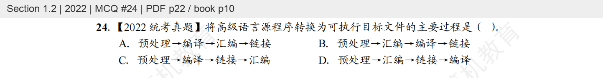

## 第2题 · 2022 / 1.3 / 教材选择31

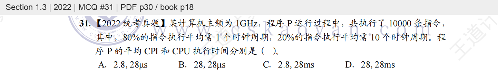

## 第3题 · 2022 / 2.1 / 教材选择34

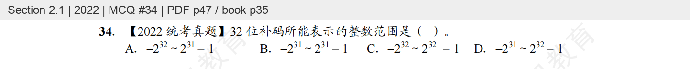

## 第4题 · 2022 / 3.2 / 教材选择35

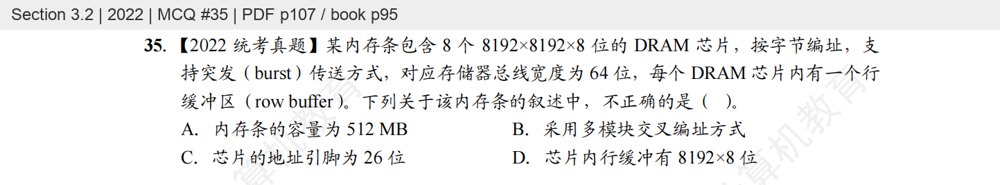

## 第5题 · 2022 / 3.5 / 教材选择34

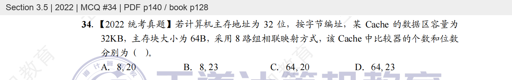

## 第6题 · 2022 / 4.1 / 教材选择16

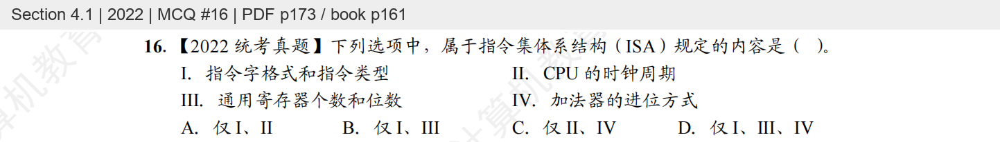

## 第7题 · 2022 / 4.1 / 教材选择17

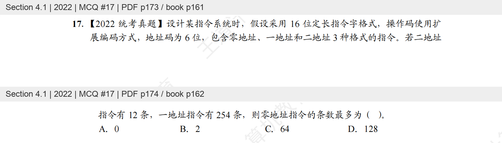

## 第8题 · 2022 / 5.7 / 教材选择12

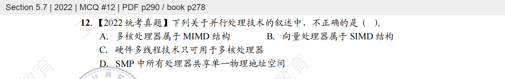

## 第9题 · 2022 / 7.3 / 教材选择53

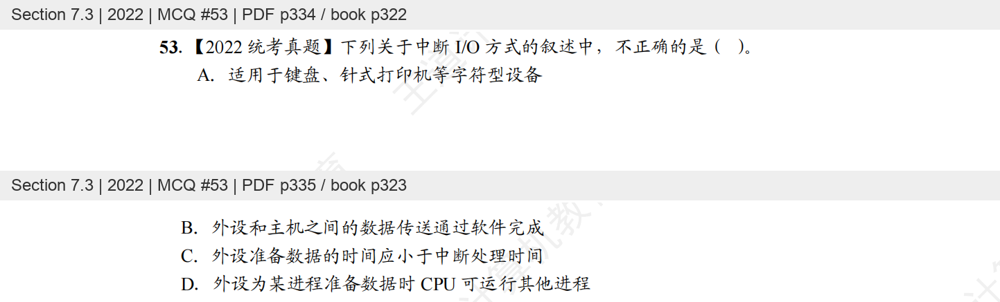

## 第10题 · 2023 / 2.3 / 教材选择49

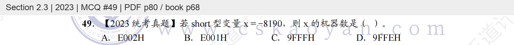

## 第11题 · 2015 / 3.6 / 教材选择18

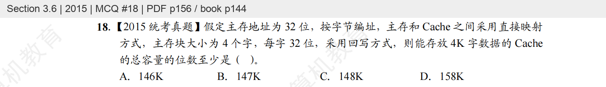

## 第12题 · 2022 / 5.3 / 教材综合10

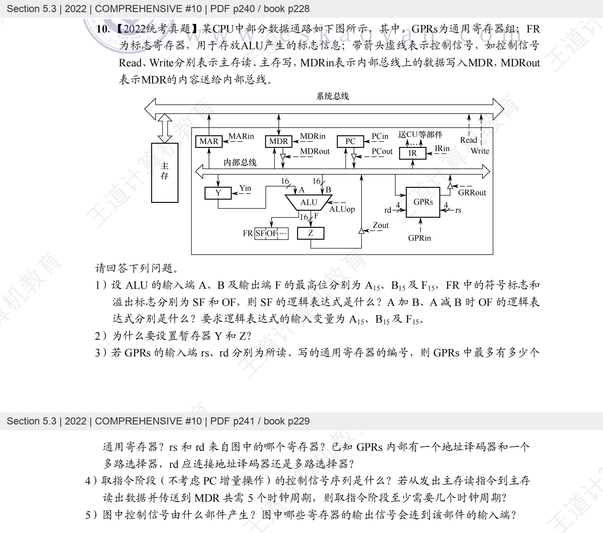

## 第13题 · 2022 / 7.3 / 教材综合11

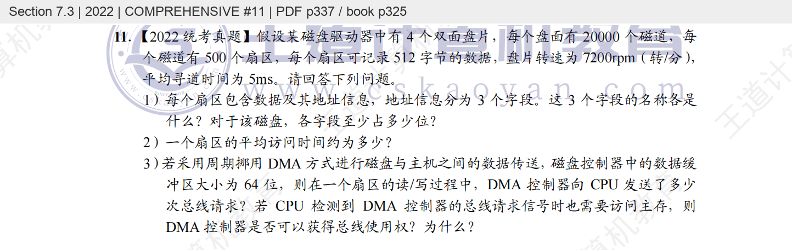

