# 2026-10-27 计组自组卷C（候选）

> 尚未完成施测前核对，请勿提前做题。仅计组部分训练，不是整套408模拟。

拟定45分、50分钟。是否练过、原图条件和评分细则尚待核定，不能据此宣布正式验收达标。原图题号是教材题号。

## 第1题 · 2021 / 1.3 / 教材选择30

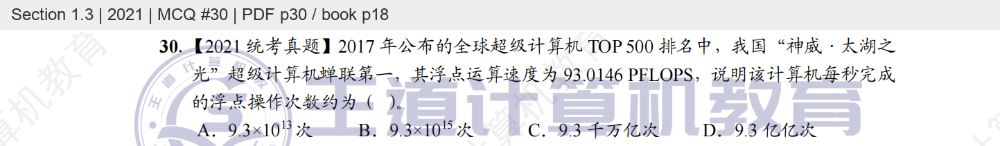

## 第2题 · 2021 / 2.1 / 教材选择33

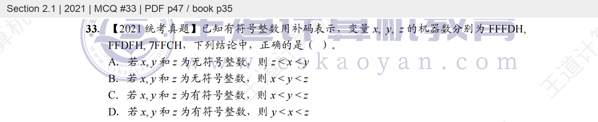

## 第3题 · 2021 / 3.3 / 教材选择16

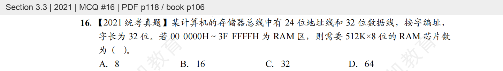

## 第4题 · 2021 / 3.5 / 教材选择33

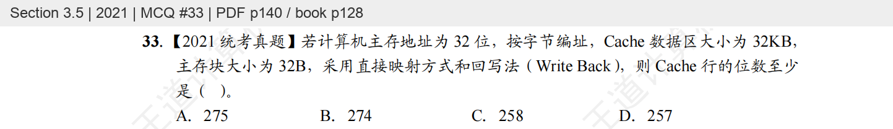

## 第5题 · 2021 / 5.3 / 教材选择11

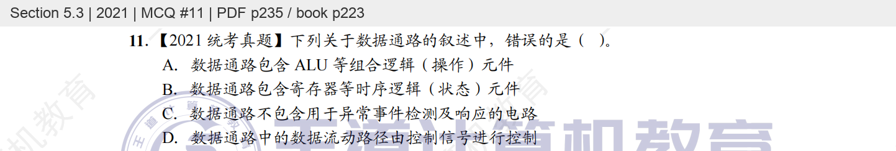

## 第6题 · 2021 / 5.4 / 教材选择27

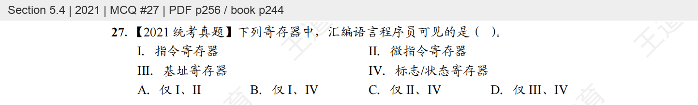

## 第7题 · 2021 / 5.4 / 教材选择28

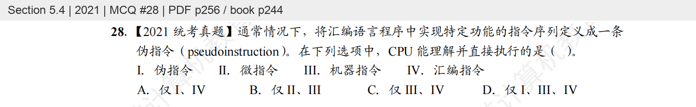

## 第8题 · 2021 / 5.5 / 教材选择13

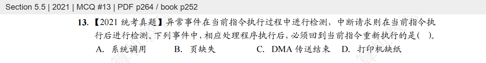

## 第9题 · 2021 / 6.2 / 教材选择18

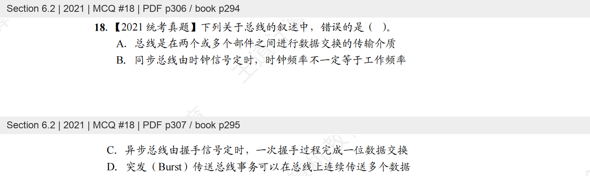

## 第10题 · 2021 / 7.2 / 教材选择18

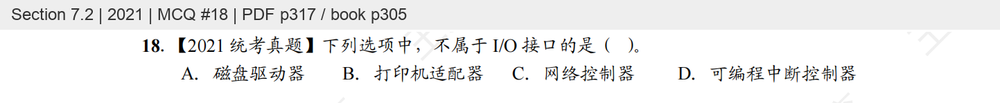

## 第11题 · 2021 / 7.3 / 教材选择52

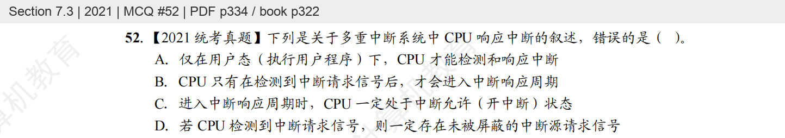

## 第12题 · 2021 / 3.6 / 教材综合07

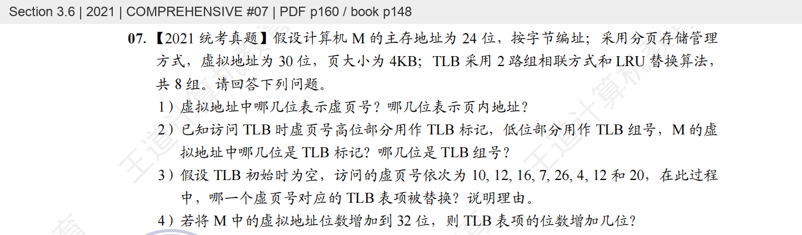

## 第13题 · 2021 / 4.2 / 教材综合08

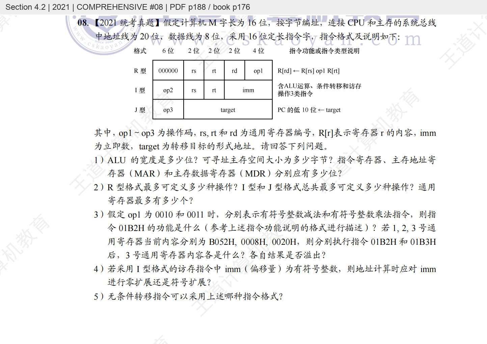

