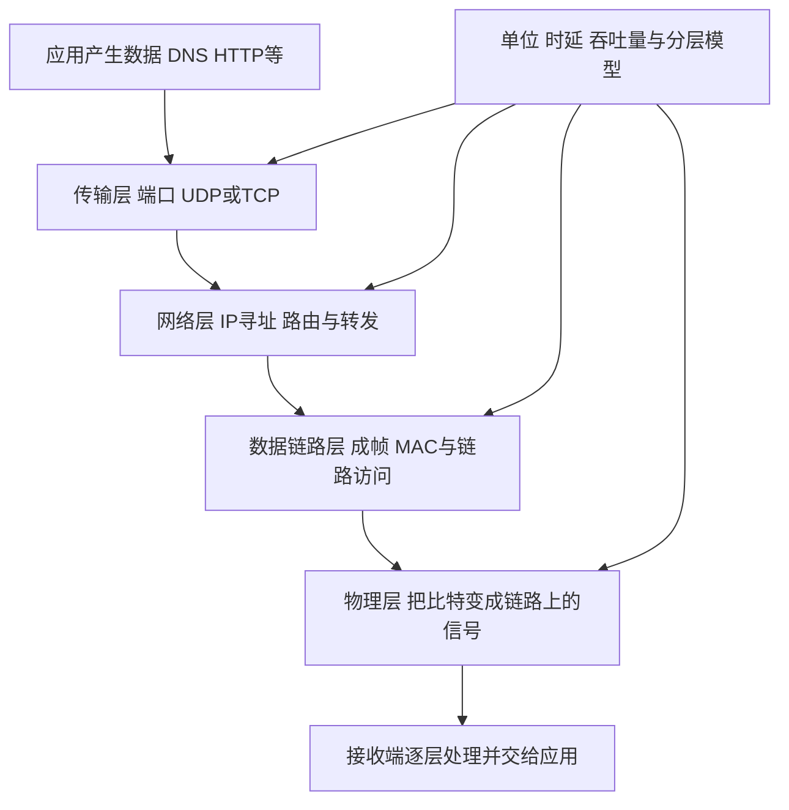

# 计算机网络核心知识地图

范围依据[2026计算机网络教材](../books/2026计算机网络_带书签.pdf)六章。下表描述待训练能力，不是用户已掌握的内容；准确小节定位见[教材目录](教材目录.md)，原题见[真题索引](真题索引.md)。正文书页 = PDF页 − 12。

## 贯穿六章的通信过程

这是端系统封装的示意。途中交换机、路由器按各自层次处理；每过一跳不等于完整拆到应用层。学习顺序先建立分层与性能概念，再从物理和链路向上展开，最后重新追踪一次完整访问。

## 第1章 计算机网络体系结构

书页1～29，PDF13～41；小节1.1～1.2。

| 核心点 | 必须理解与会做 | 条件与易混点 |
|---|---|---|
| 网络组成和交换方式 | 区分端系统、通信链路、交换设备；比较电路、报文、分组交换 | 分组交换不等于一定建立连接；数据报和虚电路需区分 |
| 发送与传播 | 说明把一帧推入链路和信号沿介质前进的区别 | 提高速率主要缩短发送时延；传播时延取决于距离和传播速度 |
| 吞吐量与瓶颈 | 识别路径瓶颈、有效数据比例、实际可达速率 | 标称链路速率不等于应用有效吞吐量 |
| 分组转发时序 | 画多跳存储转发时间线，比较分组与整报文传输 | 链路数、分组大小、首部、是否流水化、排队处理是否忽略影响结果 |
| 分层与封装 | 对照OSI和TCP/IP模型，辨别各层职责 | 不混用不同模型的层数和层名；PDU随层次变化 |
| 协议 接口 服务 | 说明同层实体之间的规则与上下层提供的功能 | 协议是对等实体的规则，服务通过层间接口体现 |

基础公式：发送时延`T发送=L/R`，L用bit、R用bit/s；传播时延`T传播=d/v`。节点中的处理、排队和发送，加上传播形成相应时延；不要把每跳的L/R漏掉或重复算。单向链路在途比特数可用`R×T传播`理解，端到端窗口需求还需根据ACK往返时序计算。

验证：给出简单多跳拓扑，指出数据首比特与末比特分别何时到达，解释每一段时间代表什么。

## 第2章 物理层

书页30～50，PDF42～62；小节2.1～2.3。章名以正文为准，PDF书签误写已记录勘误。

| 核心点 | 必须理解与会做 | 条件与易混点 |
|---|---|---|
| 数据 信号 码元 | 区分模拟/数字、码元速率与比特率、单工/半双工/全双工 | 波特不是bit/s；码元承载比特数取决于可区分状态数 |
| 奈奎斯特与香农 | 根据带宽、状态数、噪声条件选公式或同时检查两种约束 | Hz与bit/s不可混淆；S/N线性比值与dB先换算 |
| 编码与调制 | 按约定读/画NRZ、曼彻斯特、差分曼彻斯特等波形；辨认ASK/FSK/PSK/QAM | 编码的0/1映射和初始电平以题目或教材为准；不能只认图形不查约定 |
| 传输介质与接口 | 比较双绞线、同轴、光纤、无线；区分接口四类特性 | 介质本身与物理层协议职责不能混为一谈 |
| 中继器与集线器 | 解释信号再生与共享介质的作用 | 集线器不按MAC地址选择转发端口，也不能当路由器 |

在教材的理想低通信道模型下，奈氏上限为`2B log₂M`；有噪声信道的香农容量为`B log₂(1+S/N)`，其中B为Hz，M为可区分状态数，S/N为线性比值。若给出dB，按`S/N=10^(dB/10)`换算。公式使用条件要先说明，不能把其中一个结论当成所有信道的通则。

验证：先说清输入量的含义与单位，再计算速率，并检查状态数和噪声是否同时限制结果。

## 第3章 数据链路层

书页51～125，PDF63～137；小节3.1～3.8。

| 核心点 | 必须理解与会做 | 条件与易混点 |
|---|---|---|
| 成帧与透明传输 | 字符计数、字节填充、零比特填充、违规编码 | 区分数据区与帧界定符；填充规则要能够正向和逆向操作 |
| 差错控制 | 奇偶校验、CRC模2除法，理解海明码基本思想 | 检错不等于自动重传或纠错；CRC余数长度由生成多项式次数决定 |
| 停止等待 | 追踪发送、ACK、超时与重传；计算利用率 | 从哪一时刻计时、ACK发送时间、误码假设必须明确 |
| GBN与SR | 区分累计确认、选择重传、乱序接收和窗口滑动 | GBN常规接收窗口为1；SR需区分新帧与旧帧，不能无限增大发送窗口 |
| 信道划分 | FDMA、TDMA、WDM、CDMA的基本机制与题目中的码片运算 | CDMA先确认码片正负表示、发送0/1/静默的规则 |
| 随机接入 | ALOHA、CSMA、CSMA/CD、CSMA/CA | 检测到空闲不能保证之后无碰撞；碰撞检测与碰撞避免机制不同 |
| 以太网 | MAC帧、最小/最大帧长、填充、共享与交换以太网 | CSMA/CD对应共享半双工场景，不能直接套到全双工交换链路 |
| 无线局域网 | 隐藏站、RTS/CTS、ACK、退避、802.11地址字段 | 根据ToDS/FromDS和拓扑确定地址角色，不死背三个地址的位置 |
| VLAN与PPP | 理解VLAN广播范围、标记和PPP成帧/透明传输 | VLAN不是“每个端口一个广播域”的无条件规则；PPP不等于以太网 |
| 交换机与网桥 | 按源MAC学习，按目的MAC查表，未知目的泛洪，解释过滤 | 学习依据是源地址；广播域、冲突域、转发表和路由表分清 |

采用k位帧序号的常规模型：GBN发送窗口至多`2^k−1`且接收窗口为1；SR要求发送与接收窗口之和不超过`2^k`，等大时各至多`2^(k−1)`。先说明协议模型，不将这些限制直接当作TCP字节窗口公式。

在无差错、忽略处理时间、ACK不构成瓶颈的停止等待模型中，可用`U=T数据发送/(T数据发送+2T传播+TACK发送)`分析链路利用率。滑动窗口题先画多个帧与ACK的时间线，再根据题意推导，避免把所有RTT定义当成相同。

共享半双工以太网的经典碰撞检测约束为`最短帧发送时间≥最坏往返传播时间`；题目若加入中继/处理延时，应纳入相应往返时间。只在该模型下推最小帧长。

验证：独立完成一张发送/接收窗口表和一个交换机学习过程，能解释丢帧、丢ACK或目的未知时发生什么。

## 第4章 网络层

书页126～220，PDF138～232；小节4.1～4.7。

| 核心点 | 必须理解与会做 | 条件与易混点 |
|---|---|---|
| 网络层服务与SDN | 数据报/虚电路，路由与转发，控制平面与数据平面 | 路由协议生成/维护路径信息，转发处理当前分组；两者不可互换 |
| IPv4首部 | 总长度、首部长度、标识、DF/MF、偏移、TTL、协议、首部校验 | IPv4总长度含首部；首部校验范围与TCP/UDP不同 |
| IPv4地址与子网 | 地址与掩码按位与，求网络地址、主机范围、子网划分 | `2^h−2`仅用于常规含网络/广播地址的子网，不能机械套特殊前缀 |
| CIDR与聚合 | 求共同前缀、判断聚合覆盖范围、按最长前缀匹配转发 | 最长前缀比默认路由更具体；聚合可能覆盖未实际使用的地址 |
| 分片与MTU | 求分片数据量、总长度、偏移和MF，检查能否分片 | MTU口径按题目；偏移单位为8字节；不能把首部算进数据偏移 |
| ARP与逐跳封装 | 在本地链路查下一跳MAC；说明跨网段时为何找网关 | 普通无NAT路由中端到端IP地址保持，而逐跳链路首部可能变化 |
| NAT与端口转换 | 按转换表追踪内外地址/端口 | NAT存在时不能仍声称IP地址永不改变；映射依据以题目为准 |
| DHCP与ICMP | DHCP配置交互、ICMP差错/查询、理解ping等例子 | 解释获得配置前的地址和广播条件；ICMP不是可靠交付保证 |
| IPv6 | 地址长度与书写、基本首部、与IPv4的主要区别、过渡方法 | 不把IPv4路由器分片流程套到IPv6；压缩表示必须可还原 |
| 路由算法与协议 | 距离向量、链路状态；RIP、OSPF、BGP的范围与更新 | 区分自治系统内/间；RIP更新需考虑来自哪个邻居，不只机械取最小值 |
| 多播与移动IP | 多播组与IGMP、地址映射；归属与转交地址的基本流程 | 多播不等于向所有主机广播；IP多播地址与链路多播地址不是一一对应 |
| 路由器与域的划分 | 区分接口、路由表、转发表、冲突域和广播域 | 设备所处层次、VLAN和链路模式共同决定范围 |

对于普通IPv4分片题，若各片首部长度均为H字节，则非末片最大数据量为`8×floor((MTU−H)/8)`；偏移为该片数据在原数据报数据区的起点除以8。再检查最后一片、首部选项、DF/MF及题目是否涉及再次分片，不能只背一个固定数值。

验证：在同一拓扑上完成地址规划、路由匹配、下一跳ARP和逐跳字段变化，再加入MTU限制；综合题尽量沿同一个分组追踪。

## 第5章 传输层

书页221～262，PDF233～274；小节5.1～5.3。

| 核心点 | 必须理解与会做 | 条件与易混点 |
|---|---|---|
| 端口与复用分用 | 解释进程间通信、端口、套接字和连接标识 | IP用于主机/接口层次，端口用于传输层分用；不能只用一个端口标识所有连接 |
| UDP | 首部、长度、伪首部参与校验、无连接服务 | UDP保持报文边界；提供差错检测不等于提供可靠交付 |
| TCP序号与ACK | 按字节编号，理解累计确认，追踪重传和乱序 | ACK指下一个期望字节；SYN和FIN各占一个序号，纯ACK通常不占 |
| 建连与释放 | 三次握手、连接释放、状态转换和TIME-WAIT | 两方向独立关闭；图中ACK与FIN可否合并按具体条件判断 |
| 可靠传输 | 超时重传、重复ACK、确认与计时基本机制 | 不把收到重复ACK直接当成超时；教材算法与题目约定优先 |
| 流量控制 | 接收窗口、滑动过程、零窗口 | rwnd限制接收方能力，与网络拥塞不是同一件事 |
| 拥塞控制 | cwnd、ssthresh、慢开始、拥塞避免、快重传/恢复 | 按题目指定算法，分清超时与重复ACK事件；窗口单位可能是字节或MSS |
| 综合吞吐 | 联合cwnd/rwnd、RTT、MSS及未确认数据求发送量与时间 | 窗口上限不等于此刻还能新发多少；还要扣除已发送未确认部分 |

在题目采用的常规模型下，发送窗口上限受`min(cwnd,rwnd)`约束，当前可新发的数据还需扣除已发送未确认量，并受应用待发数据等限制。若窗口用MSS个数表示，先转换到统一单位；TCP慢开始或拥塞避免按给定ACK与轮次模型逐步更新，不凭图形猜曲线。

验证：给定报文交互图，逐条填写seq、ack、接收窗口与发送状态；再根据丢包事件解释拥塞窗口如何变化。

## 第6章 应用层

书页263～299，PDF275～311；小节6.1～6.5。

| 核心点 | 必须理解与会做 | 条件与易混点 |
|---|---|---|
| C/S与P2P | 区分服务角色、通信关系与分布方式 | 客户端/服务器是进程角色，不是固定的机器等级 |
| DNS | 域名层次、服务器分工、递归与迭代、缓存 | 分清主机→本地域名服务器与服务器间查询；缓存命中会改变往返次数 |
| FTP | 控制连接、数据连接、主动/被动模式 | 控制端口21不等于所有数据连接都固定使用20；连接发起方依模式变化 |
| 邮件 | 用户代理、邮件服务器、SMTP、POP3、IMAP、MIME | 发送/中继与读取邮件不是同一个协议任务；MIME处理内容格式 |
| HTTP | 请求/响应、对象、持久/非持久、流水线、缓存 | RTT数量取决于DNS、建连、对象数量、连接复用和题目忽略项 |
| 跨层过程 | 从URL到DNS、传输连接、IP转发、链路封装再到响应 | 已有缓存、已有连接与新建连接不能按同一时延公式计算 |

传输关系采用教材基本模型：DNS使用53端口，可用UDP或TCP；FTP控制连接使用TCP，SMTP/POP3等教材邮件场景使用TCP。HTTP时序计算应标明版本及连接模型，不能把教材HTTP/1.x的假设推广到所有HTTP实现。实际协议版本差异有需要时另查原始资料。

验证：对一次访问画参与主机与服务器、报文顺序和每段RTT，分别说明“有缓存”和“无缓存”改变哪一步。

## 常用图表与自检

| 任务 | 先画什么 | 最后检查什么 |
|---|---|---|
| 发送与传播、HTTP等待 | 时间线 | 首比特/末比特、起止时刻、RTT是否重复计入 |
| ARQ/TCP | 序号、窗口和事件表 | 发送量、确认含义、序号空间、单位 |
| IP地址与转发 | 地址位段和路由表 | 前缀包含关系、最长匹配、下一跳 |
| 网络综合 | 拓扑与每跳首部表 | IP/MAC/端口角色、哪些字段改变及为什么 |

这些工具用于解释具体题目的规则和因果关系，不能代替完整作答。阶段掌握以无提示新题和后续间隔检验为依据。
